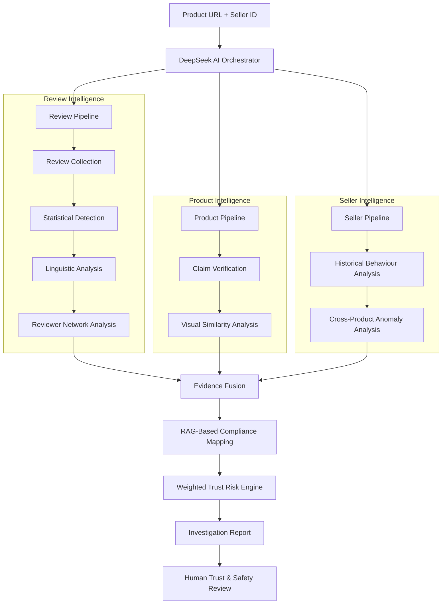
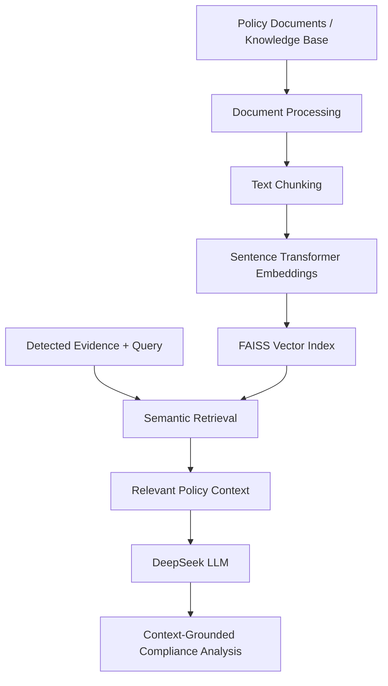

# 🛡️ Trust Detection System
### An Agentic AI Framework for E-Commerce Review Authenticity, Counterfeit Risk & Seller Intelligence

<p align="center">

**Detect. Investigate. Correlate. Explain.**

A multi-agent AI-powered trust and safety system designed to identify suspicious e-commerce activities through review analysis, product verification, seller behaviour analysis, and evidence-based risk assessment.

</p>

---

## 🚀 Overview

The **Trust Detection System** is an AI-driven investigation framework that aims to address growing trust and authenticity challenges in e-commerce marketplaces.

Traditional detection approaches often examine fake reviews, counterfeit products, and seller irregularities independently. Our approach brings these capabilities together through a coordinated **multi-agent AI architecture**.

Given a **Product URL and Seller ID**, the system coordinates specialized agents to investigate review behaviour, product claims, visual similarities, reviewer relationships, and historical seller activities.

The collected findings are consolidated through an evidence-fusion mechanism, supported by Retrieval-Augmented Generation (RAG) for contextual policy retrieval, and evaluated through a transparent risk-scoring engine.

The final output is an explainable investigation report designed to assist human Trust & Safety and compliance investigators.

> **Our philosophy:** A suspicious signal is not proof of fraud. Every risk assessment should be supported by evidence and remain open to human verification.

---

## 🎯 Problem Statement

E-commerce marketplaces face several interconnected trust and safety challenges:

- Manipulated or incentivized customer reviews.
- Artificial review bursts and abnormal rating distributions.
- Coordinated reviewer groups operating across multiple products.
- Misleading product descriptions and unverified authenticity claims.
- Suspicious product-image reuse across unrelated listings.
- Repeated irregularities across multiple products associated with a seller.

Investigating these signals independently can result in fragmented evidence and missed relationships.

**Our solution:** An integrated AI investigation system that correlates multiple evidence sources to generate a consolidated trust-risk assessment.

---

## 🧠 Key Capabilities

| Capability | Description |
|---|---|
| Review Intelligence | Detects abnormal review volumes, rating distributions, and temporal patterns. |
| Linguistic Analysis | Identifies repetitive language and semantic similarities between reviews. |
| Reviewer Network Analysis | Examines reviewer-product relationships and potentially coordinated activity. |
| Product Claim Verification | Compares product claims with publicly available external information. |
| Visual Similarity Analysis | Identifies potentially reused or visually similar product images. |
| Seller Intelligence | Examines historical seller activity and repeated anomalies across listings. |
| RAG-Based Compliance Support | Retrieves relevant policy information to support contextual compliance analysis. |
| Evidence Fusion | Consolidates findings from different investigation pipelines. |
| Explainable Risk Assessment | Produces a weighted risk score with supporting evidence. |
| Investigation Reporting | Generates structured reports for human investigation. |

---

## 🏗️ System Architecture

The system follows a centralized orchestration model with three specialized investigation pipelines.



### 1. Review Pipeline

Investigates customer reviews and reviewer behaviour.

- **Review Data Collection Agent:** Collects available review text, ratings, timestamps, and reviewer information.
- **Statistical Detection Agent:** Identifies unusual review bursts, rating distributions, and temporal anomalies.
- **Linguistic Analysis Agent:** Uses semantic embeddings to identify unusually similar review content.
- **Reviewer Network Agent:** Analyses relationships between reviewers, products, and sellers to identify potential coordination patterns.

### 2. Product Pipeline

Investigates product information, claims, and images.

- **Claim Verification Agent:** Extracts product claims and compares them with publicly available external evidence.
- **Visual Analysis Agent:** Uses image embeddings and similarity search to identify potentially reused product images and suspicious visual patterns.

### 3. Seller Pipeline

Investigates seller-level historical behaviour.

- Examines historical activity across multiple product listings.
- Correlates review, product, image, and claim anomalies.
- Identifies repeated suspicious patterns associated with the same seller.
- Generates seller-level risk indicators.

---

## ⚙️ Technology Stack

| Category | Technologies |
|---|---|
| Programming Language | Python |
| LLM & Orchestration | DeepSeek |
| Web Search | Tavily |
| Web Extraction | Firecrawl, Playwright |
| Data Processing | Pandas, NumPy, SciPy |
| Machine Learning | Scikit-learn |
| NLP & Embeddings | Sentence Transformers |
| Vector Database | FAISS |
| Graph Analytics | NetworkX |
| Computer Vision | CLIP, PyTorch, OpenCV, PIL |
| RAG | Sentence Transformers, FAISS, DeepSeek |
| Development Environment | Google Colab |

---

## 🔍 How the System Works

**Step 1 — Investigation Input**

The user provides:

- Product URL
- Seller ID

**Step 2 — Intelligent Orchestration**

The DeepSeek orchestrator coordinates the investigation workflow and delegates relevant tasks to specialized agents.

**Step 3 — Parallel Investigation**

The Review, Product, and Seller pipelines analyse their respective evidence sources.

**Step 4 — Pattern Detection**

Statistical methods, semantic similarity, graph analysis, and image similarity techniques identify potentially suspicious signals.

**Step 5 — RAG-Based Context Retrieval**

Relevant policy documents and contextual information are retrieved using embeddings and FAISS to support compliance analysis.

**Step 6 — Evidence Fusion**

Findings from different agents are consolidated into a structured evidence record.

**Step 7 — Risk Assessment**

A Python-based weighted scoring mechanism calculates the overall trust-risk score.

**Step 8 — Investigation Report**

The system generates an explainable report containing detected signals, supporting evidence, risk classification, and recommendations for human review.

---

## 🧮 Risk Assessment Framework

The Trust Risk Engine combines evidence signals from multiple investigation modules.

An example configurable weighting framework:

| Evidence Category | Weight |
|---|---:|
| Statistical Anomalies | 15% |
| Linguistic Similarity | 15% |
| Reviewer Network | 20% |
| Product Claim Risk | 15% |
| Visual Similarity | 15% |
| Seller Risk | 20% |
| **Total** | **100%** |

The weighted risk calculation follows:

\[
R = \sum_{i=1}^{n} w_i s_i
\]

Where:

- \(R\) = Overall trust-risk score
- \(w_i\) = Weight assigned to an evidence category
- \(s_i\) = Normalized risk signal

The score is calculated programmatically rather than allowing the LLM to invent a numerical result.

*Weights and thresholds are configurable design parameters and should be calibrated against labelled evaluation data.*

---

## 🧠 RAG Integration

The system incorporates a Retrieval-Augmented Generation approach to support contextual compliance analysis.

### RAG Workflow



RAG helps connect detected suspicious patterns with relevant policy information rather than relying entirely on the LLM's internal knowledge.

---

## 📊 Demonstration Output

The prototype's captured demonstration produced the following investigation summary:

| Metric | Demonstration Result |
|---|---|
| Trust Risk Score | 54/100 |
| Risk Classification | MEDIUM |
| Evidence Items | 4 |
| Recommended Action | Human Investigation |

**Interpretation:**

The demonstration generated a medium-risk assessment and displayed supporting evidence for further investigation.

This is an example of the reporting workflow, not a validated fraud-detection accuracy measurement.

---

## 📸 Application Screenshots

### Investigation Input

<!-- Add your actual input UI screenshot here -->

`[Insert Product URL and Seller ID input screenshot]`

### Risk Assessment Dashboard

<!-- Add your actual risk dashboard screenshot here -->

`[Insert Trust Risk Score screenshot]`

### Final Investigation Report

<!-- Add your actual investigation report screenshot here -->

`[Insert Final Investigation Report screenshot]`

---

## 📁 Project Structure

The following is a suggested logical structure for organizing the Colab prototype. Adapt filenames to match the actual repository.

```text
Trust-Detection-System/
│
├── notebooks/
│   └── trust_detection_system.ipynb
│
├── agents/
│   ├── orchestrator.py
│   ├── review_collection.py
│   ├── statistical_detection.py
│   ├── linguistic_analysis.py
│   ├── reviewer_network.py
│   ├── claim_verification.py
│   ├── visual_analysis.py
│   └── seller_risk.py
│
├── rag/
│   ├── document_processing.py
│   ├── embeddings.py
│   └── vector_retrieval.py
│
├── core/
│   ├── evidence_fusion.py
│   ├── compliance_mapping.py
│   └── risk_engine.py
│
├── reports/
│   └── investigation_report.py
│
├── data/
│   └── sample_data/
│
├── screenshots/
│
├── requirements.txt
├── .env.example
├── .gitignore
└── README.md
```

---

## 🛠️ Installation & Setup

The prototype is designed to run in Google Colab.

### 1. Clone the repository

```bash
git clone https://github.com/YOUR_USERNAME/YOUR_REPOSITORY.git

cd YOUR_REPOSITORY
```

### 2. Install dependencies

```bash
pip install -r requirements.txt
```

### 3. Configure API credentials

Create a `.env` file or configure secrets in Google Colab.

```env
DEEPSEEK_API_KEY=your_deepseek_api_key
TAVILY_API_KEY=your_tavily_api_key
FIRECRAWL_API_KEY=your_firecrawl_api_key
```

Never upload API keys, passwords, or private credentials to GitHub.

### 4. Run the notebook

Open the project notebook in Google Colab, configure the required credentials, install dependencies, and execute the investigation workflow.

*The exact installation commands and environment variables may vary according to the repository's actual implementation.*

---

## 🛡️ Responsible AI & Human Oversight

The system is designed as an investigation-support framework, not an automated enforcement mechanism.

- Suspicious patterns are treated as risk indicators, not proof of fraud.
- Image similarity does not independently establish counterfeit authenticity.
- High review volume does not automatically imply manipulation.
- External information is evaluated according to its availability and reliability.
- Final enforcement decisions remain with authorized human investigators.

---

## 🚧 Current Limitations

- Marketplace websites may restrict automated access to public information.
- Incomplete historical data can affect seller-level analysis.
- Limited labelled datasets constrain model validation.
- Legitimate product-image reuse can generate false-positive signals.
- Risk thresholds and weights require further calibration.

---

## 🔮 Future Enhancements

- Train and evaluate anomaly detection models using labelled marketplace datasets.
- Improve coordinated reviewer detection through advanced graph-learning methods.
- Expand multimodal product verification.
- Introduce source-grounded policy retrieval and citation tracking.
- Improve risk-score calibration and uncertainty estimation.
- Extend the system to support additional marketplace platforms.
- Improve investigation traceability and human feedback integration.

---

## 👥 Team Members

| Name | Division | Roll Number |
|---|---|---|
| Taha Sayyed | D17A | 54 |
| Navin Sharma | D17A | 55 |
| Ayush Shelar | D17A | 57 |
| Abhinav Racharla | D17A | 48 |

**Institution:** Vivekanand Education Society's Institute of Technology (VESIT)

**Department:** Computer Engineering

**Academic Year:** 2026–2027

---

## 📚 References & Research Foundation

The project draws inspiration from research in:

- Fake review and spammer detection.
- Reviewer-group and heterogeneous graph analysis.
- Online counterfeit product and seller detection.
- Multimodal image and text representation.
- Retrieval-Augmented Generation.
- Explainable AI and human-in-the-loop investigation.

Selected research:

1. Lewis et al. (2020) — *Retrieval-Augmented Generation for Knowledge-Intensive NLP Tasks.*
2. Radford et al. (2021) — *Learning Transferable Visual Models From Natural Language Supervision.*
3. Liu et al. (2008) — *Isolation Forest.*
4. Cao et al. (2021) — *Fake Reviewer Group Detection in Online Review Systems.*

---

## ⭐ Acknowledgement

We acknowledge the guidance and support of our faculty mentors and the resources that helped us explore agentic AI, machine learning, retrieval-augmented generation, and multimodal intelligence.

---

<p align="center">

### Built to make digital marketplaces more trustworthy.

**Trust Detection System — From Suspicious Signals to Explainable Evidence.**

</p>
